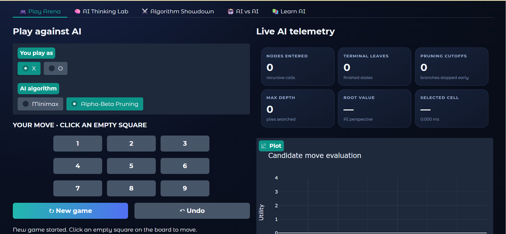
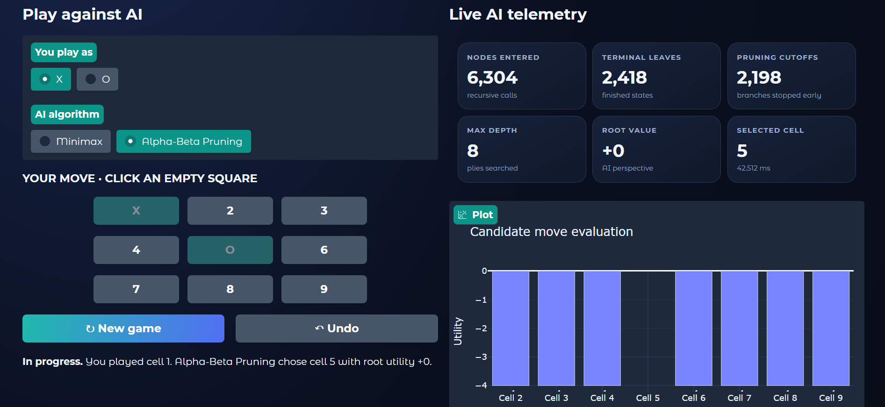
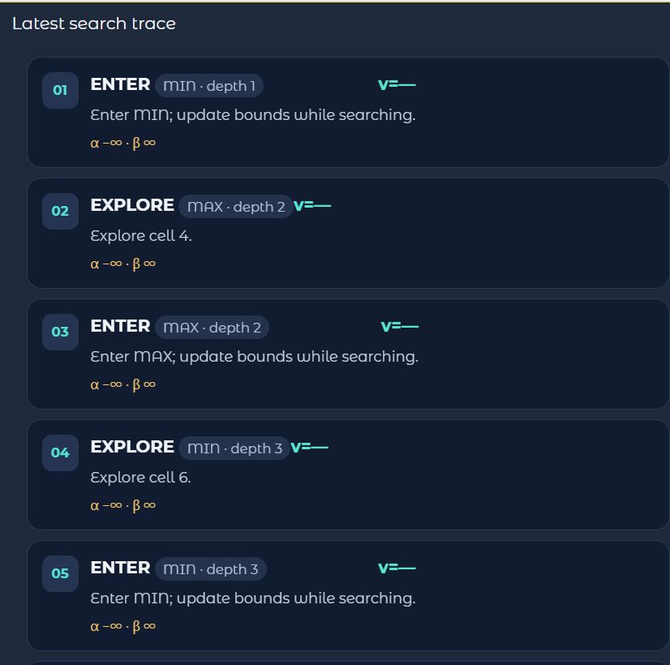
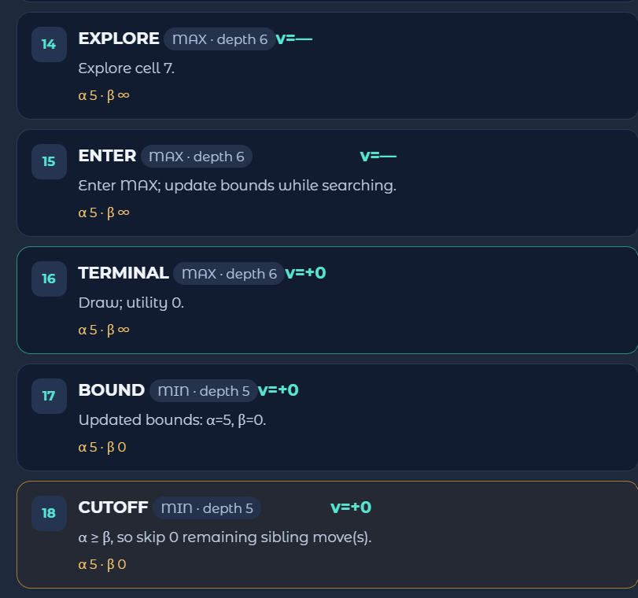
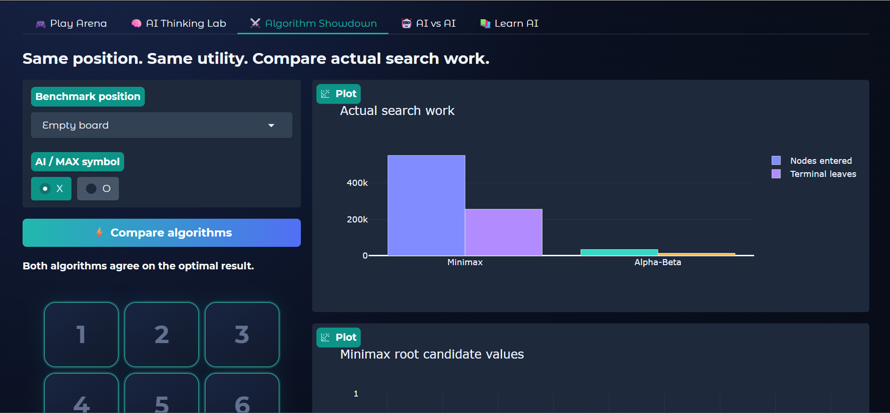

<div align="center">

# AI Strategy Arena

### An Interactive Tic-Tac-Toe Environment for Minimax and Alpha-Beta Pruning

Explore how classical Artificial Intelligence searches possible moves, evaluates outcomes, and avoids unnecessary work through an interactive visual lab.

**Python · Gradio · Plotly · Adversarial Search**

</div>

---

## Overview

**AI Strategy Arena** is an educational application that demonstrates adversarial search using Tic-Tac-Toe. It allows users to play against an AI agent, inspect the search process, compare Minimax with Alpha-Beta Pruning, and run AI-versus-AI matches.

Rather than treating the AI as a black box, the application exposes candidate move values, search statistics, and recorded search events. This is a classical search project; the AI does not train on game data or learn from previous matches.

## Features

- **Interactive Play Arena** — click directly on an empty square to make a move.
- **Two AI algorithms** — choose Minimax or Alpha-Beta Pruning.
- **Live AI telemetry** — inspect nodes entered, terminal leaves, pruning cutoffs, maximum depth, root utility, selected cell, and search time.
- **AI Thinking Lab** — analyze built-in positions or enter a custom board.
- **Search trace** — inspect `ENTER`, `EXPLORE`, `TERMINAL`, `BOUND`, and `CUTOFF` events.
- **Candidate move chart** — compare the utility scores of available moves.
- **Algorithm Showdown** — compare search work on the same position.
- **AI vs AI** — choose the algorithm used by X and O and run a match.
- **Learn AI** — review utility, game-tree search, pruning, and complexity.
- **Game controls** — start a new game or undo the previous move.

## Application Screenshots

> These screenshots are from the application demonstration.

### 1. Play Arena — Initial State



The main game view includes the interactive board, player and algorithm choices, and live AI telemetry.

### 2. Play Arena — AI Search Metrics



The metrics panel shows the search work recorded for the displayed run. The values depend on the current position and are not fixed performance guarantees.

### 3. AI Thinking Lab — Search Trace



The trace lists search events, including recursive entry, exploration, terminal evaluation, bound updates, and pruning cutoffs.

### 4. Algorithm Showdown



The comparison view runs Minimax and Alpha-Beta Pruning on the same selected position and visualizes their recorded search work.

### 5. Additional Application View



An additional screenshot supplied with the project report.

## How It Works

1. The board is represented by nine cells containing `X`, `O`, or an empty value.
2. The game logic generates legal moves and detects wins, draws, and ongoing games.
3. The selected algorithm explores possible future board states.
4. Terminal states receive a utility score from the AI player's perspective.
5. Minimax propagates values back through the game tree. Alpha-Beta Pruning uses bounds to skip branches that cannot change the final decision.
6. The interface displays the chosen move, candidate values, search statistics, charts, and recorded trace events.

## Technology Stack

| Technology | Purpose |
|---|---|
| Python | Game logic, search algorithms, state handling, and callbacks |
| Gradio | Interactive web interface |
| Plotly | Candidate-move and algorithm-comparison charts |
| `math` | Infinity values and numerical comparisons |
| `time` | Search-time measurement |
| `dataclasses` | Structured search-statistics storage |

## Run in Google Colab

The project is provided as a notebook named `AI_Strategy_Arena_Colab.ipynb`.

1. Open [Google Colab](https://colab.research.google.com/).
2. Choose **File → Upload notebook**.
3. Upload `AI_Strategy_Arena_Colab.ipynb`.
4. Run the cells from top to bottom.
5. The notebook installs the required libraries and launches the Gradio application.
6. Open the Gradio URL printed by the final cell.

**Sharing note:** The notebook uses `share=True`, which creates a shareable public URL while the session is active. Anyone with access to that URL may be able to open the demo. Do not enter private information, and stop the runtime when finished.

For a local-only launch, change the final line to:

```python
app.queue().launch(debug=False)
```

## Application Sections

### Play Arena
Play as X or O against the selected AI algorithm. Click an empty square to make a move. Occupied cells become unavailable. If you choose O, the AI plays X first when a new game is started.

### AI Thinking Lab
Choose a predefined position or enter a custom board using nine characters in row-major order:

- `X` — X mark
- `O` — O mark
- `-` — empty cell

Example: `XX-OO----`

The lab displays candidate move scores, a search trace, and a layered visualization of recorded search states. The trace retains up to 2,500 events for visualization responsiveness; the search itself is not stopped at that limit.

### Algorithm Showdown
Compare Minimax and Alpha-Beta Pruning on the same board. The application reports root utility, optimal move sets, node counts, terminal leaves, cutoffs, runtime, and node-count reduction for that run.

### AI vs AI
Select an algorithm for each player, choose a starting position, and set the maximum number of additional moves. The application reports the result and a move-by-move log.

### Learn AI
Review the core ideas behind game states, MAX and MIN turns, utility, pruning, and complexity.

## Understanding the Metrics

| Metric | Meaning |
|---|---|
| **Nodes Entered** | Number of recursive search calls recorded by the algorithm. |
| **Terminal Leaves** | Number of completed game states (win, loss, or draw) evaluated during the search. |
| **Pruning Cutoffs** | Number of times Alpha-Beta stops exploring remaining sibling branches. One cutoff can skip multiple states. |
| **Max Depth** | Deepest search level reached from the current search root. |
| **Root Value** | Utility calculated for the position from the AI's perspective. |
| **Selected Cell** | Cell selected by the AI, numbered from 1 to 9. |
| **Elapsed Time** | Search duration in milliseconds; it varies by position and runtime environment. |
| **Candidate Move Utility** | Score calculated for a legal candidate move. A higher score is better for the AI under the chosen scoring convention. |
| **Alpha (α)** | Best value MAX can guarantee along the current search path. |
| **Beta (β)** | Best value MIN can guarantee along the current search path. |

### Utility convention

The implementation assigns positive utility to an AI win, negative utility to an AI loss, and `0` to a draw. Win and loss values are adjusted by depth, encouraging faster wins and, where possible, delaying forced losses. A negative score means the outcome is unfavorable for the AI under the search assumptions; it does not automatically indicate an error.

## Main Code Components

| Function / component | Responsibility |
|---|---|
| `moves()` / `winner()` / `status()` | Legal moves and win/draw detection |
| `valid_board()` / `next_player()` | Board validation and turn selection |
| `utility()` | Scores terminal outcomes |
| `Stats` / `ev()` | Stores metrics and records search events |
| `minimax()` | Implements Minimax search |
| `alphabeta()` | Implements Alpha-Beta Pruning |
| `search()` | Evaluates candidate moves and returns the selected move and metrics |
| `metrics()` / `bar_chart()` | Creates the telemetry and candidate-move chart |
| `tree_chart()` / `trace_html()` | Displays recorded search states and events |
| `play()` / `reset()` / `undo()` | Handles game interaction and controls |
| `run_analysis()` | Analyzes a selected or custom board |
| `showdown()` | Compares Minimax and Alpha-Beta Pruning |
| `aivai()` | Runs an AI-versus-AI match |

## Algorithms

### Minimax

Minimax assumes both players choose moves optimally. At a **MAX** node, the AI chooses the largest child value. At a **MIN** node, the opponent chooses the smallest child value. The values propagate toward the root, and the AI selects a move with the best root value.

Worst-case time complexity is commonly expressed as `O(b^d)`, where `b` is the branching factor and `d` is the search depth.

### Alpha-Beta Pruning

Alpha-Beta Pruning optimizes Minimax by tracking two bounds:

- **Alpha (α):** best value MAX can guarantee so far.
- **Beta (β):** best value MIN can guarantee so far.

When `α ≥ β`, the remaining sibling branches at that node can be skipped because they cannot change the final decision. The worst-case time complexity remains `O(b^d)`; with ideal move ordering, the theoretical behavior can approach `O(b^(d/2))`.

## Limitations

- The project demonstrates the algorithms using Tic-Tac-Toe.
- Search counts and runtime depend on the selected position and move ordering.
- Runtime from a single run is not a general performance guarantee.
- The visualization stores a bounded number of trace events.
- This is a classical search demonstration, not a machine-learning model.

## Possible Future Improvements

- Add automated tests for legal moves, win/draw detection, undo, and algorithm agreement.
- Export repeatable benchmark results to CSV.
- Add explicit parent-child links to the game-tree visualization.
- Add step-by-step playback of search events.
- Allow users to experiment with move-ordering strategies.
- Extend the project to other small adversarial games.

## References

1. S. J. Russell and P. Norvig, *Artificial Intelligence: A Modern Approach*, 4th ed., Pearson, 2021.
2. D. E. Knuth and R. W. Moore, “An Analysis of Alpha-Beta Pruning,” *Artificial Intelligence*, vol. 6, no. 4, pp. 293–326, 1975.
3. Python documentation: <https://docs.python.org/3/>
4. Gradio documentation: <https://www.gradio.app/docs>
5. Plotly Python documentation: <https://plotly.com/python/>

---

**Project:** AI Strategy Arena  
**Topic:** Minimax and Alpha-Beta Pruning for Tic-Tac-Toe  
**Author:** Nitesh Kumar Sah
